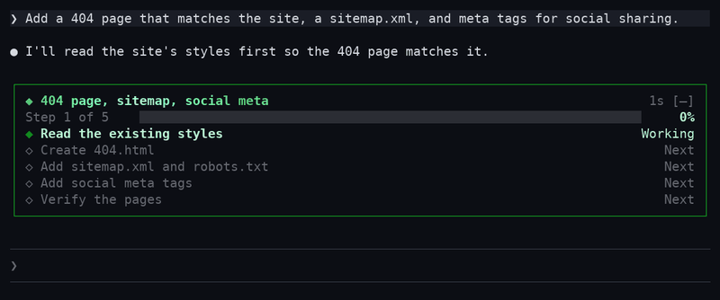
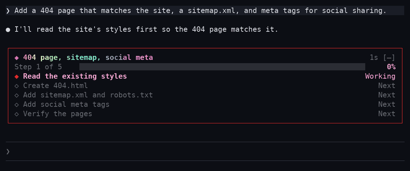
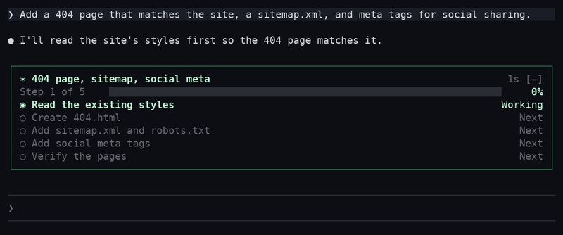
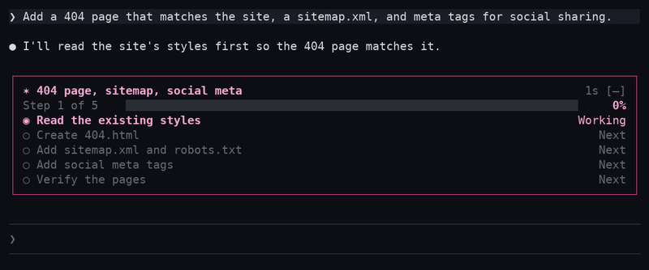
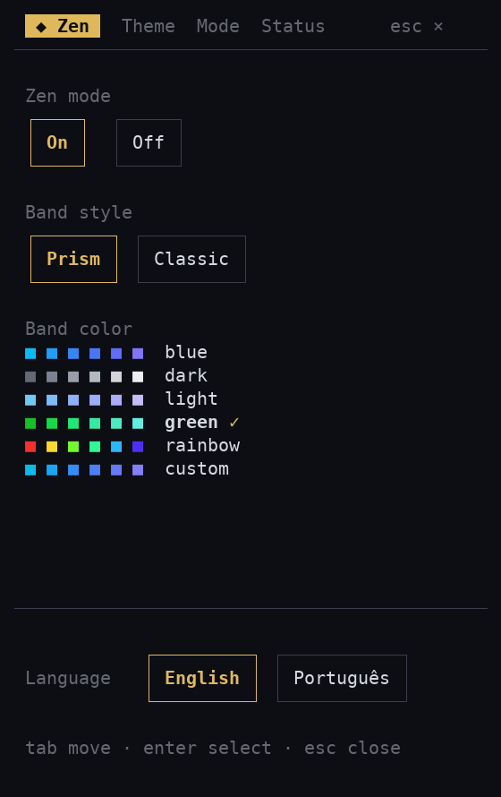
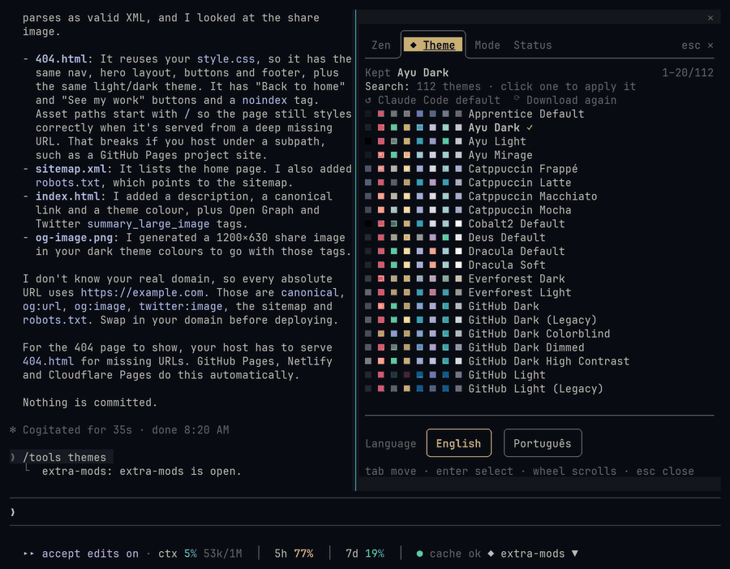
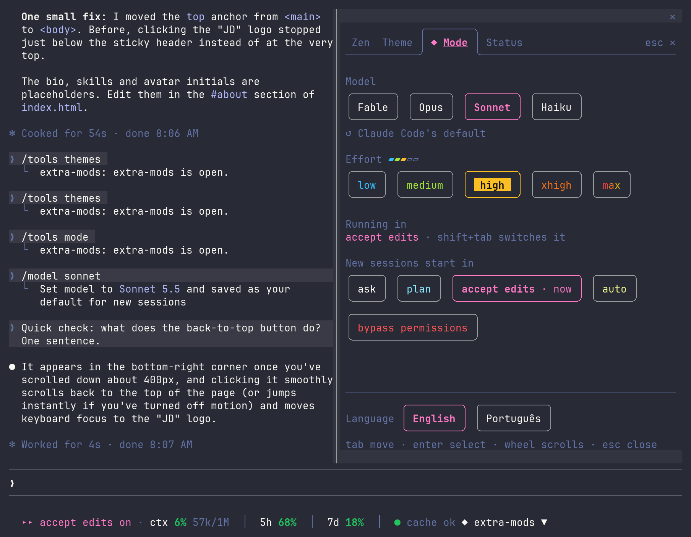
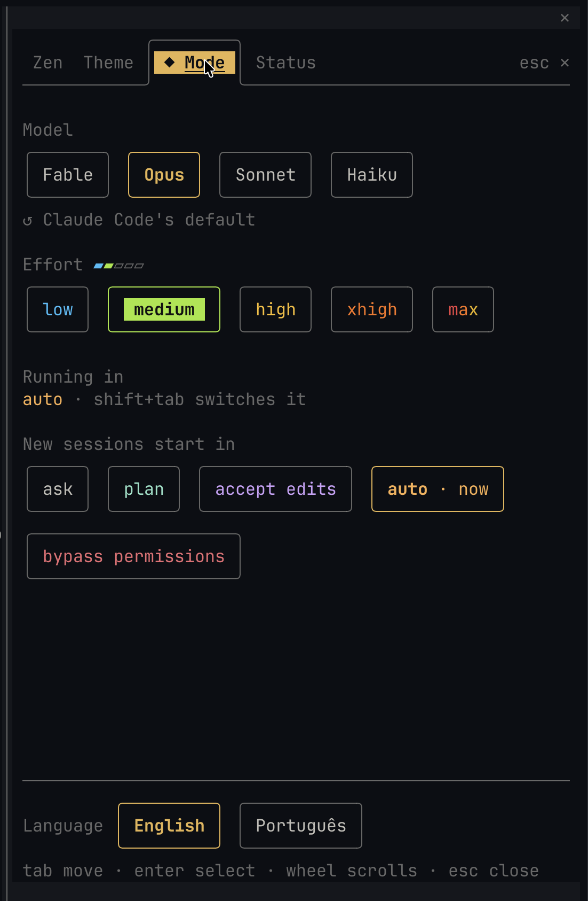
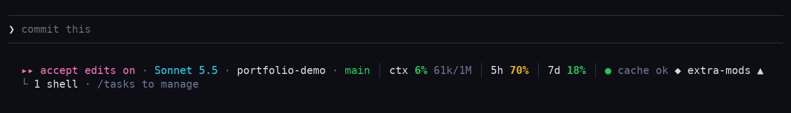
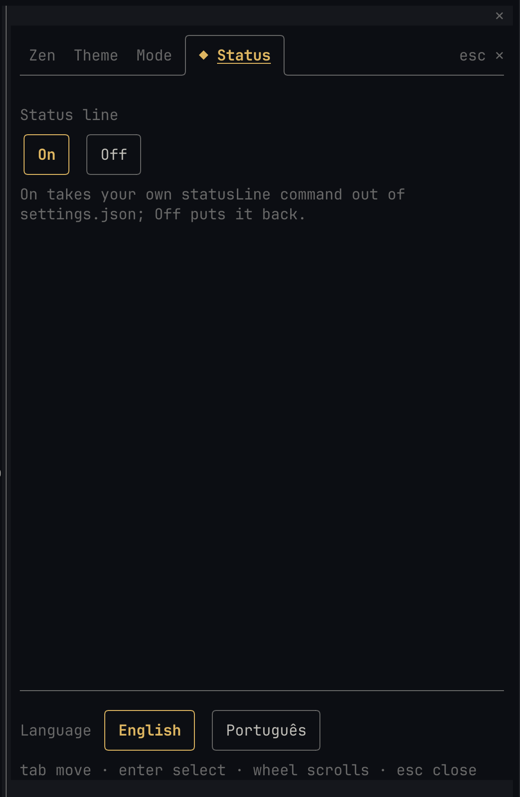

<h1 align="center">Claude Mods</h1>

<p align="center">A sidebar for <a href="https://claude.com/claude-code">Claude Code</a>: Zen mode, themes, model and effort, and a status line.</p>

<p align="center"><b>English</b> · <a href="README.pt-BR.md">Português</a></p>

<p align="center"><a href="#zen">Zen</a> · <a href="#theme">Theme</a> · <a href="#mode">Mode</a> · <a href="#status">Status</a> · <a href="#install">Install</a></p>

## Zen

Hides all tool calls and giant code blocks and shows just a progress bar and small progress reports.

Pick a style and a color in the Zen tab. **Prism** (the default) gives every cell its own color, flowing along the bar with a glint passing through. **Classic** keeps flat colors.

**Prism** · green



**Prism** · rainbow



**Classic** · green



**Classic** · rainbow



Band colors: blue, dark, light, green, rainbow or custom.



## Theme

Applies any of 100+ themes from [terminalcolors.com](https://terminalcolors.com) with one click.



## Mode

Switches the model and effort, and picks the mode new sessions start in.





## Status

Shows model, folder, branch, context, 5h/7d limits and cache state on one row.





The sidebar speaks English and Português. Keys: **Tab** moves, **Enter** selects, **Esc** closes.

## Install

Needs Claude Code 2.1.292 or newer.

```
claude plugin marketplace add Jhonatan-de-Souza/ClaudeMods
claude plugin install extra-mods@jdsjh-mods --scope user
```

Run `/reload-plugins` (or start a new session), then click **◆ extra-mods ▲** at the bottom right, or type `/tools`.

To update: `claude plugin marketplace update jdsjh-mods && claude plugin update extra-mods@jdsjh-mods`

<details>
<summary><b>Good to know</b></summary>

- **Zen:** Claude gets a `zen_progress` tool to post its plan and update each step. `[–]` shrinks the band to one line. Band colors: blue, dark, light, green, rainbow or custom.
- **Theme:** themes download once to `~/.claude/extra-mods/themes/`. The pick is written as `~/.claude/themes/extra-mods.json` and set in `~/.claude/settings.json`. Restart Claude Code once the first time; after that themes change live. The terminal background follows too, on Windows Terminal (for the session, then restored) and on terminals that take OSC colors (Ghostty, iTerm2, kitty, WezTerm, Terminal.app).
- **Mode:** the model switch runs Claude Code's own `/model`. The effort level applies to every request and is remembered. A running session's permission mode changes with **shift+tab**; the pick here is saved as `permissions.defaultMode`.
- **Status:** on by default. It takes your own `statusLine` out of `settings.json` and puts it back when you turn it off. Background shells and monitors show on a second row; click it for `/tasks`.
- Every settings file is backed up first, as `*.extra-mods.bak`.

</details>

<details>
<summary><b>Install with an AI agent</b></summary>

Point your coding agent at this repository and ask it to install the mod. Steps for the agent (ask the user before step 4):

1. Run `claude --version`; it must be 2.1.292 or higher.
2. Run `claude plugin marketplace add Jhonatan-de-Souza/ClaudeMods`.
3. Run `claude plugin install extra-mods@jdsjh-mods --scope user`.
4. *Optional, only if the user doesn't want the mod's status line:* copy `statusline/statusline.py` to `~/.claude/statusline.py` and set `"statusLine": { "type": "command", "command": "python ~/.claude/statusline.py", "refreshInterval": 2 }` in `~/.claude/settings.json` (`python3` on macOS and Linux).
5. Check `claude plugin list` shows `extra-mods` enabled, then tell the user to run `/reload-plugins`.

On Windows, use forward slashes in paths when running in Git Bash.

</details>

## Develop

```
claude --plugin-dir ./plugins/extra-mods
claude plugin validate ./plugins/extra-mods
claude plugin test ./plugins/extra-mods
```
